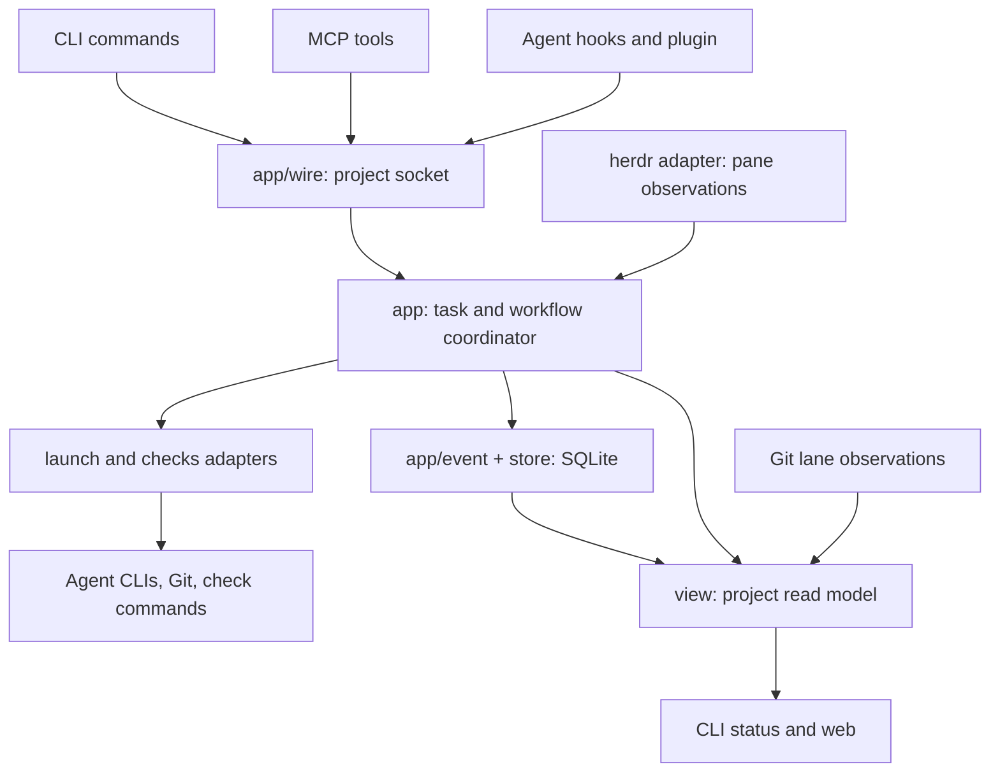

# Architecture proposal — 2026-11-05

Review baseline: `ef9a8bc0` (`Merge T-869`). This is a proposal; production code, tests, design contracts, and the backlog were not edited. Measurements below use tracked files, include comments and blank lines, and exclude generated frontend assets. Prior research was checked against the current implementation rather than treated as a current inventory.

## Recommendation

Keep the single Go binary, SQLite, and the existing adapter boundaries. Concentrate simplification inside the coordinator: one ordered path for state changes, fewer independent workflow lifecycles, and cheaper observations of Git and agent state. Preserve durable handling of actions that can move main, reuse a lane, or deliver a job.

The package structure is largely coherent. The expensive complexity comes from interactions between task state, review state, briefs, messages, stops, and recovery. A small workflow addition can require a fact, a fold, a claim, a timer, a status interpretation, an answer path, and several recovery tests. Moving those responsibilities into more packages would preserve most of that work.

The highest-value outcome is a lower cost for the next feature or fix. Line reduction should follow removal of responsibilities and mechanisms. The previous test-pruning wave is evidence that deleting tests directly is a poor first move here.

## Current size and structure

| Scope | Implementation files | Implementation lines | Test files | Test lines |
|---|---:|---:|---:|---:|
| Runtime Go, excluding test helpers and test/probe programs | 179 | 44,717 | — | — |
| All tracked Go, including helpers and test/probe programs | 195 | 50,032 | 268 | 76,498 |
| `internal/app` itself, excluding its three child packages | 50 | 14,328 | 112 | 33,788 |
| `cmd/obor` | 31 | 4,467 | 51 | 12,344 |
| `internal/setup` | 9 | 3,434 | 9 | 4,186 |
| `internal/checks` | 10 | 2,632 | 14 | 3,723 |
| `internal/launch` | 10 | 2,540 | 13 | 5,656 |
| `internal/guard` | 8 | 2,807 | 9 | 3,424 |
| `internal/config` | 6 | 2,301 | 7 | 1,922 |

There are 1,408 top-level Go test functions in tracked source. The non-test Go support/probe code accounts for another 5,315 lines. Authored TypeScript, Svelte, and JavaScript under `web/` and `opencode/` account for 3,557 non-test lines and 920 test lines; these include build/configuration files.

`internal/app` holds about 32% of runtime Go and 44% of Go test lines. In the latest 60 non-merge commits, non-test Go grew by 1,047 lines and tests by 2,114. The most frequently touched implementation files include `app.go`, `loop.go`, the event vocabulary, `messages.go`, and the review/fix/verify files. This is a sample of recent churn, not a long-term growth forecast.

The current dependency graph already shows a successful separation: **only `cmd/obor` directly imports the `internal/app` coordinator in production**. Adapters use `app/port`, `app/event`, and `app/wire`. The earlier proposal to extract these contracts has landed and should receive credit rather than become another refactoring task.



Keep clear authority boundaries:

| Information | Authority | Why another representation exists |
|---|---|---|
| Accepted task decisions and effect progress | Event log, folded by serve | Recovery after interruption |
| Lane assignment visible to hooks and CLIs | Rebuildable `lanes` projection | Fast reads, including while serve is down |
| Actual worktree contents and ancestry | Git | People and external commands can change a worktree |
| Agent location and activity | Current pane observations, reconciled with identity proofs | An event from an old session cannot authorize action on its replacement |
| Displayed project state | `view` joining these inputs | CLI and web share interpretation |

These are useful distinctions. Simplification should make their relationships explicit and eliminate repeated reconstruction, while preserving each authority.

## 1. Fix observation failures before caching observations

**Confirmed issue:** [LaneState](/Users/djordjeradakovic/Work/obor-kit/internal/checks/lanetable.go:71) discards the error from `git status --porcelain`. If ancestry says the lane is merged, a failed status read can still produce `State: "free", Dirty: false`, without a warning. [Rows](/Users/djordjeradakovic/Work/obor-kit/internal/checks/lanetable.go:163) also turns a failed lane-table read into an empty map.

An audit-only Go overlay test reproduced the first case on a temporary fixture: let all Git commands succeed except `status --porcelain`, which exits 1. The availability check failed with:

```text
git status failed, yet lane is available: state="free" dirty=false warning=""
```

This establishes an incorrect availability report. The probe did not attempt dispatch or demonstrate lost work. Dispatch consumes this classification, so the error should be fixed at the reader boundary.

**Proposal:** carry an explicit observation error/unknown result through the lane adapter. Dispatch refuses an unreadable lane; the view displays the reason. Keep “no database yet,” “no assignment,” and “database unreadable” distinct. Return meaningful Git stderr. This implements the existing fail-closed principle.

Also complete context propagation through this boundary. `port.Lanes.Lanes` takes no context, and [project.Git](/Users/djordjeradakovic/Work/obor-kit/internal/project/project.go:126) uses `exec.Command`. A canceled web request or serve pass cannot cancel those Git reads. [Lane.Prepare](/Users/djordjeradakovic/Work/obor-kit/internal/checks/lane.go:31) accepts a context, but its configured setup checks reach [runIn](/Users/djordjeradakovic/Work/obor-kit/internal/checks/lane.go:144) with `context.Background()`.

**Acceptance:** failed Git/DB reads never authorize reuse; cancellation reaches lane inspection and configured setup commands; canceled child processes are cleaned up. Keep a small failure table for this boundary. This work may add lines and is worth doing before optimization.

## 2. Make state mutation one ordered operation

[App](/Users/djordjeradakovic/Work/obor-kit/internal/app/app.go:76) has seven mutexes; `proj` adds the verify mutex, alongside task claims, scratch ownership, and publish admissions. The count itself is less important than having to reason about several independently serialized operations.

There are three orders to coordinate: validate a command against current state, append its record, and fold that record into live state. In [recordSeq](/Users/djordjeradakovic/Work/obor-kit/internal/app/loop.go:342), the append completes before `App.mu` is acquired for the fold. The log serializes appends, while handlers also depend on feature-specific locks. This leaves append order and live application order dependent on surrounding call paths. That is an architectural risk identified by inspection; this review did not reproduce a live/replay divergence.

**Proposal:** establish one coordinator-owned commit path whose explicit invariant is “live records are applied in the same order replay reads them.” Admission checks that depend on that state belong to the same decision boundary. Inventory existing callers that already hold `App.mu` before changing the locking.

The operational shape should stay simple:

```text
validate against current state → record intent/decision → apply it and reserve work
perform the external effect outside the state lock
record result → apply it → release the reservation
```

Long checks, Git operations, agent stops, and startup waits remain outside the state lock. Task reservations and scratch exclusivity still protect external work. Retire feature locks individually only after their guarantees have moved into the shared path. A new actor framework or general command bus is unnecessary for this step.

**Acceptance:** one documented append/application ordering rule; existing admission, early-verdict, drop/start, cancellation, and replay tests remain valid. Extend the replay oracle to compare live and replayed durable state for selected concurrent command sequences. A smaller lock set is an outcome, not the starting requirement.

## 3. Finish the kernel/rule separation, with completion evidence preserved

The adopted rules in `docs/design.md` are the right direction. [rules.go](/Users/djordjeradakovic/Work/obor-kit/internal/app/rules.go:44) currently registers only idle and idle-ping rules. Review verification, merge watches, needs-you repetition, and role cleanup still largely use their older mechanisms.

**Proposal:** continue the existing consolidation plan, one behavior at a time. Recompute conditions for reminders and scheduling; use current task, brief, and completion facts to determine whether the obligation remains. A rule should call an existing action or emit a line. It should not acquire a second durable lifecycle of its own.

The review/fix/verify group is the strongest candidate: `reviewfix.go` and `reviewverify.go` together have 693 implementation lines. Simplify the scheduling half while preserving the evidence that a particular reviewer completed a brief at a particular head for particular fixes. `review close` must still refuse incomplete work. Sending a brief is insufficient evidence of verification.

Likewise, distinguish an idle role's background cleanup from stopping a worker before lane reuse or stopping an agent before a fresh brief. Ordering-sensitive stops remain in the kernel. A repeated cleanup must never stop the next session that happened to reuse the pane.

**Acceptance:** each conversion deletes its old counters, dedicated pending state, message fields, fold branches, or timers where they become redundant. Preserve the actual obligation and its observable completion. Verify that duplicate actions or one-pass delays remain within the adopted rule-tier contract.

## 4. Untangle messages from the features they acknowledge

[event.Message](/Users/djordjeradakovic/Work/obor-kit/internal/app/event/data.go:44) carries feature-specific fields including `Needs`, `Watch`, `Review`, `Stop`, `Drive`, `Stopped`, `VerifyOf`, `VerifyFail`, and `FixDrop`, alongside the new `Of` reference. `messages.go` is 1,294 lines because it coordinates delivery and several workflows' acknowledgements.

**Proposal:** during each rule conversion, move the corresponding notification reference to `Of{Kind, Seq}` and delete its superseded interpretation. Keep delivery mechanics responsible for recipient, text, session routing, retry, and supersession. Let the feature interpret its own completion evidence.

Use this as a gradual ownership cleanup. A broad rewrite of every message shape would create a risky migration and recreate the same coupling behind an abstraction. `Ends`, brief supersession, and verification completion may have different meanings; preserve those meanings explicitly.

**Acceptance:** fewer cross-feature branches in the message fold; no parallel old/new interpretations after their compatibility window. Consider extracting pure outbox state only if this leaves a small interface. Preserve the three existing contract packages.

## 5. Remove repeated Git work from the event path

The current path is `App.event → check → decideLanes → checks.Lanes → LaneTable.States`. Every relevant pane event can synchronously scan all configured lanes. Each existing worktree normally costs at least three Git processes: revision/branch inspection, ancestry, and status; merge-evidence checks can add more. Four lanes therefore normally mean at least twelve Git processes per scan.

The scans run in serve's stream-processing path. The existing buffered `kick` coalesces merge-loop wakes, but it does not coalesce the preceding lane scan. `LaneTable`'s `sync.Once` lasts for one table instance, and each scan constructs a new instance.

**Proposal:** process pane observations immediately and coalesce expensive lane reconciliation. Refresh Git facts after obor's own worktree operations, on a bounded periodic reconciliation for external edits, and on an authoritative preflight before reuse. Pane status alone should not force a fresh Git scan of every lane.

Initially, a dirty flag plus the existing pass/tick may be enough; choose a shorter refresh bound only if needed. Include observation age/error when serving a cached display. A stale “free” value must never be the final authority for a destructive operation.

**Acceptance:** a burst of pane status events shares a bounded number of lane scans; external edits are observed within the stated bound; a reuse preflight still detects dirty worktrees and failures. Measure Git calls per burst and event-handling latency, not only line count.

## 6. Make read paths proportional to the requested page

[view.Load](/Users/djordjeradakovic/Work/obor-kit/internal/view/load.go:19) asks serve, loads configuration, opens the store, scans background processes, and builds Git lane facts. That is appropriate for a project overview.

[web.detail](/Users/djordjeradakovic/Work/obor-kit/internal/web/web.go:487) also builds this complete view before task and agent detail reads. The setup endpoint does so too. The frontend refreshes live data every five seconds and also refreshes after event bursts, so unrelated work multiplies with open pages. The `/api/job` endpoint has already been narrowed and should serve as the example.

**Proposal:** keep all interpretation in `view`, while giving it narrower loaders for task, agent, setup, and summary reads. Share pure mapping helpers with the full overview. A task detail needs live task/needs-you information and its store rows; it does not need every lane's dirty status or a process scan. Agent background details can be requested explicitly.

Within one serve pass or request, load effective config once and pass that immutable value to the functions involved. `LoadDaemon` currently re-reads and decodes files; `reconcile` can call it while `App.mu` is held. Prefer a per-operation snapshot before introducing persistent config caching. New requests must still observe role removal and other authorization changes.

**Acceptance:** job and task detail reads spawn no Git or `ps` processes unless their requested data requires them; CLI and web still agree; serve-down behavior is preserved. Add a narrow JSON contract check for Go/TypeScript only if drift is recurring. A schema/code-generation framework is disproportionate here.

## 7. Improve historical reads without introducing another database model prematurely

[CurrentAt](/Users/djordjeradakovic/Work/obor-kit/internal/store/sessions.go:131) reads historical session facts and runs `Owned` before selecting one agent's current session. `Owned` repeatedly calls `Admits`, which scans prior sessions and checks other agents' current ownership through further scans.

With S sessions and A agents, the ownership work can approach O(A × S²), with a cubic worst case if A also grows with S. With a fixed small agent set it is closer to quadratic. The earlier unconditional O(N³) description overstates the normal case.

**Proposal:** fold ownership in one pass with explicit maps for known `(agent, session)` records, each agent's current session, and current session ownership. Preserve timestamp tie-breaking, confirmation of a preselected session's transcript, and the earlier owner's precedence. Keep one owner for this logic so serve and readers agree.

The event and prompt tables currently have their primary keys and no secondary indexes. Task timelines, session facts, and prompt lookups filter by other columns. Check query plans on a copied or synthetic representative store, then add only useful indexes such as `events(task, seq)` or the appropriate prompt lookup column plus `id`. Indexes trade faster reads for extra writes and migration work.

`ReadMerges` also loads the whole log and filters in Go; filter in SQL before decoding. These are smaller changes than adding persisted session projections or event snapshots. Full replay and retained intent/result maps deserve measurement as history grows, but no startup/RSS measurement here justifies a snapshot subsystem now.

**Acceptance:** identical ownership/results over existing session cases, bounded query work for detail reads, and measured query-plan improvement. Preserve one-writer discipline and `synchronous=FULL` for durable steps.

## 8. Complete the remaining command ownership gaps

Most commands already send a request to serve. Two exceptions matter:

- [review close](/Users/djordjeradakovic/Work/obor-kit/cmd/obor/reviewcycle.go:135) still reads state, removes review files, updates the backlog, and commits in the CLI; serve later discovers the close through Git polling.
- `obor drive` gets a decision from serve, waits for a worker stop, and starts the driver from the client. A client exit can interrupt this continuation even though serve accepted the decision.

**Proposal:** move review-close mutation and its completion fact under serve, coordinated with other main-checkout writers. If drive stays, serve should own its continuation after the accepted takeover. Keep terminal/UI presentation in the CLI.

Treat the review-close filesystem/Git sequence as real recovery work: moving it across a package boundary alone does not make it crash-safe. Define how a retry recognizes a completed commit or partial file change. The benefit is one owner and removal of polling/client continuation.

`App.Listen` separately repeats method lists and dispatch rules. Replace this with one plain handler registration table when touching that code. Retain the existing wire shape initially; per-method request types are optional later, not a prerequisite for simplification.

**Acceptance:** accepted state changes finish independently of the CLI process; retry uses the same call identity; review closure produces direct evidence for role cleanup. Existing CLI smoke tests remain, while duplicate orchestration assertions move to the owner.

## Test strategy: fewer expensive fixtures, preserved scenarios

The backlog records that the previous pruning wave saved roughly 1k lines after restores and new safety tables, with several review rounds required. The older survey's roughly 12k-line candidate pool is historical evidence, not a current deletion list. Some candidates have already gone, and coverage-equivalent tests proved to protect different entry points or timing.

I recommend a small pilot in one behavior group, with an explicit scenario inventory:

| Test responsibility | Appropriate fixture | What to retain |
|---|---|---|
| State transitions, rule conditions, identity proof selection | In-memory state and an explicit clock/pass | Input → decision/state assertions, including meaningful refusals |
| Append, projection, restart and replay | Temporary SQLite store | Durable order, failed writes, interrupted effects, replay equality |
| Git gate, publish, conflict and worktree behavior | Real Git in temporary repos | Ancestry, patch identity, conflict recovery, dirty-work protection |
| herdr socket and MCP protocol | Their fake transports | Actual serialization, errors, routing and reconnect behavior |
| CLI and web entry points | Small wiring fixtures plus representative end-to-end flows | Flags, caller identity, response rendering, serve-down behavior |
| Real agent compatibility | Existing live conformance workflow | Agent launch, identity and MCP behavior that stubs cannot establish |

The repository already has much of this support: the manual `harness`, `loopRig`, `concRig`, `reviewRig`, `testkit`, and `herdrtest`. Reuse the smallest suitable existing fixture; avoid replacing them with one universal test framework.

Specific changes worth trying:

1. Move pure rules and selection cases onto manual passes and existing in-memory fakes. Keep representative tests through the real socket. A rule scheduling test should not need a full Git merge to reach its precondition.
2. Consolidate repeated setup for closely related cases, retaining named cases and isolation. Combining files or function shells alone does not remove much cost.
3. Separate timeout-policy assertions from waiting out production durations. `TestTurnFailsAtItsDeadline` took 8.81 s; `TestFreshBriefAdmissionTimeoutStopsNothing` took 6.05 s. Keep their guarantees, but exercise cancellation/retry using an explicit short duration at the internal function boundary and test production default selection separately. Avoid a mutable process-global test clock or a broad timing framework.
4. Preserve at least one workflow test for each real entry point and the important kernel crash/interleaving scenarios. When a crash mechanism is deleted under the rule-tier contract, replace its obsolete tests with condition/action cases.
5. Keep manifest, reference, and command-wiring checks. Remove editorial requirements such as a description containing the exact words “Use when” unless those words have a runtime meaning. This is a small cleanup; behavioral safety tests carry more value.

For every deletion, name the behavior protected, the remaining test that protects it, and whether the old test also exercised another caller, ordering, or restart point. Statement coverage is supporting evidence only. A pilot succeeds when setup/code shrinks and review requires no restoration of lost scenarios.

## Delivery order and expected reduction

| Order | Work | Main benefit | Completion evidence |
|---|---|---|---|
| 1 | Lane-read validity and context propagation | Correct availability and cancellation | Failure/cancellation table; confirmed issue no longer reproduces |
| 2 | Narrow task/setup reads; coalesce Git reconciliation | Lower process/IO overhead | Process counts and freshness guarantees |
| 3 | Finish one rule conversion and remove its old message/fold state | Lower cost of workflow changes | Net mechanism deletion, preserved completion evidence |
| 4 | Review close through serve; drive continuation if retained | One mutation owner, fewer recovery actions | Client exit/retry and commit evidence |
| 5 | Ordered coordinator commit path, retiring redundant feature locks individually | Easier concurrency and replay reasoning | Live/replay and admission scenarios |
| 6 | Session folding and measured query indexes | Better behavior with longer history | Ownership equivalence and query measurements |
| 7 | One test-fixture/pruning pilot, then reassess | Less maintenance and gate work | Smaller fixture/test diff with no lost scenario restores |

Some steps overlap the already adopted architecture plan. Continue those tasks and attach these acceptance criteria; creating a competing consolidation wave would add coordination cost.

For the remaining rule/message, command, and compatibility cleanup, **a first verified tranche around 0.5–1.5k runtime lines and 1–3k test lines removed is a reasonable planning hypothesis**. These ranges are estimates from the reviewed ownership groups, overlap with ongoing work, exclude the safety/performance work that may add code, and are not a promised net reduction. A deletion diff and its review should replace each estimate.

Larger reductions require a product decision. Drive-specific files alone contain 841 implementation lines and 1,263 test lines, plus shared branches elsewhere. Removing drive could remove a meaningful feature-sized slice; retaining it means giving it the same single-owner discipline as other tasks. This audit did not inspect live usage, so it cannot recommend deletion based on frequency. The adopted one-release usage census remains the right basis.

Retain Go, the adapter split, SQLite durability, shared CLI/web interpretation, and the existing conformance boundary. Further package splitting, a language migration, generic workflow configuration, or a new execution framework have weak deletion cases at this stage. The two highest-value metrics are fewer owner/lead recovery actions per merged task and fewer places that must change to add one workflow rule. Track line count and gate time alongside those.

## Verification and limits

- Read the current design, module map, state model, backlog/handoff, existing architecture and pruning research, and implementation/test paths across the coordinator, store, checks, launch, agent bridges, hooks, CLI, web, and read model. This was a source/path review, not a line-by-line correctness proof of all runtime code.
- `go list -json ./...` reported 34 packages; the production import graph confirms the coordinator has only the CLI as a direct importer.
- Ran one focused test command covering `internal/app`, `internal/store`, `internal/web`, and `internal/checks`. The first sandboxed attempt could not bind temporary fake-herdr Unix sockets. The subsequent run with local socket access passed **683 top-level tests**, with **two skipped** and no failures. Store results were cached on that retry. Package execution times: app 76.580 s, checks 81.545 s, web 6.816 s. These are one run on this machine, not isolated benchmarks or a full gate measurement.
- Ran the separate audit-only overlay diagnostic for failed Git status. It failed as expected, demonstrating the availability issue described above. The overlay and diagnostic lived under `/private/tmp`; repository source and tests were unchanged.
- Did not run `make check`, the CLI/release/upgrade suites, frontend tests, a production workload benchmark, or live agent conformance. No real herdr panes or live project databases were used or changed. No current upstream CLI capability claims are needed for this proposal.
- Several earlier findings are already resolved: contract-package extraction, attempt-lifetime grouping, lane-write elision, the job endpoint's full-view build, the hard-coded removed-key expiry version, manual review verification, and reviewed-ref fallback. Their former estimated savings are excluded from this proposal.

## Design concerns

The recurring concern is that fixing a workflow gap often adds another durable lifecycle, and reviewing that lifecycle then adds more recovery cases. Keep the adopted kernel/rule boundary enforceable and require replacements to delete their old machinery. This changes the growth pattern more than reorganizing files.

The test-pruning process itself has already caused scenario losses and restore work. Mechanism deletion and cheaper fixtures should lead the next reduction; coverage-based deletion should remain a small, reviewed experiment.

The adapter layer should expose unknown observations consistently. Caching or simplifying those reads before fixing their error semantics could make today's incorrect availability result persist longer.
